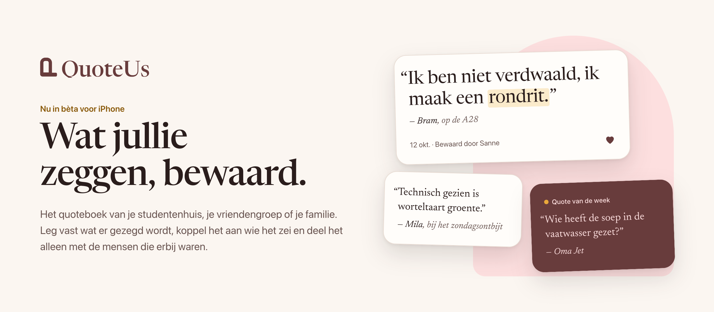

<picture>
  <source media="(prefers-color-scheme: dark)" srcset="assets/banner-dark.png">
  
</picture>

**QuoteUs** is het quoteboek van je studentenhuis, je vriendengroep of je familie. Leg vast wat er gezegd wordt, koppel het aan wie het zei en deel het alleen met de mensen die erbij waren.

- **Groepen voor iedereen.** Maak een groep voor je huis, je dispuut, je team of je familie en nodig je mensen uit.
- **Altijd de juiste auteur.** Elke quote hoort bij wie hem zei, ook als diegene de app nog niet heeft.
- **Alleen voor jullie.** Geen openbare tijdlijn, geen tracking, servers in de Europese Unie.

QuoteUs is nu in bèta voor iPhone via TestFlight. Android en een webversie volgen later.

[Website](https://quoteus.eu) · [Doe mee met de bèta](https://testflight.apple.com/join/FxUNhBHg) · [Helpcentrum](https://help.quoteus.eu) · [support@quoteus.eu](mailto:support@quoteus.eu)

De broncode van QuoteUs is niet openbaar; de repositories in deze organisatie zijn privé. Vragen of een beveiligingsprobleem gevonden? Mail [support@quoteus.eu](mailto:support@quoteus.eu).

In English

QuoteUs is the quote book for your student house, your friends or your family. Save what gets said, credit the person who said it and share it only with the people who were there. Now in beta on iPhone through [TestFlight](https://testflight.apple.com/join/FxUNhBHg); Android and a web version are coming later. The source code is not public. Questions or a security issue? Email [support@quoteus.eu](mailto:support@quoteus.eu).

